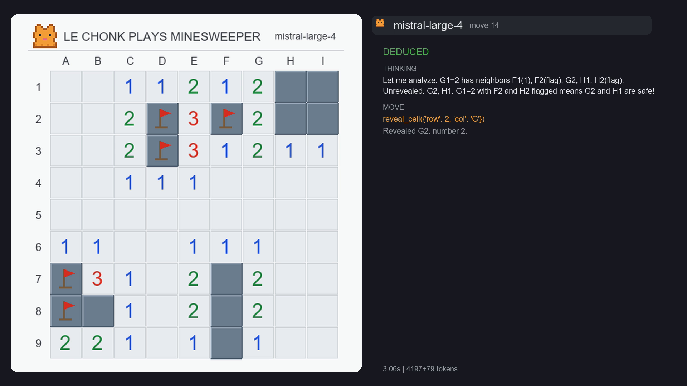

# Le Chonk plays Minesweeper

A vision-agent harness that lets **Mistral Large 4 Preview** (`mistral-large-4`) play Minesweeper using nothing but screenshots.

Built for the Mistral AI community challenge **"Le Chonk wants to play"** (October 2026).

## Demo video

[](media/le-chonk-minesweeper.mp4)

A 112-second recording of `mistral-large-4` winning a seeded beginner game (seed 1000): the exact board it sees, a "thinking" indicator while it deliberates, and its reasoning for every move. Full move log of that game: [results/video-game-s1000.json](results/video-game-s1000.json). Regenerate with `tools/record_video.py`.

## What it does

- A from-scratch, seeded Minesweeper implementation rendered to images with Pillow. No game engine, no scraping, no external assets.
- Every turn, `mistral-large-4` receives the current board screenshot (with coordinate labels drawn into the margins), its own scratchpad notes, and a transcript of recent turns. It reasons briefly and answers with tool calls: `reveal_cell`, `toggle_flag`, or `write_note`.
- The model **never** sees the grid as text, the ground truth, or the mine layout — pixels only.
- A seeded headless benchmark measures win rate, guess rate, wasted moves, and token usage. Two non-LLM baselines are included: a classic constraint solver and a random agent.

## Setup

```bash
git clone <repo-url>
cd le-chonk-minesweeper
python -m venv .venv
.venv\Scripts\activate            # Windows
pip install -r requirements.txt
copy .env.example .env            # then paste your MISTRAL_API_KEY into .env
python tests\test_game.py         # sanity check, no API needed
python tests\test_env.py          # rendering + pipeline check, no API needed
```

Requirements: Python 3.10+, a Mistral Studio API key (https://console.mistral.ai), tkinter (bundled with python.org Windows builds) for the demo window.

> Note: the challenge requires the model name `mistral-large-4` (not `mistral-large-latest`); that is the default everywhere in this repo.

## Usage

### Watch it play (windowed demo)

```bash
python -m src.play --seed 7
```

Opens a window showing the board and, below it, the model's live reasoning, tool call, and the game's feedback for every move. Record this window with OBS Studio (or any screen recorder) for the demo video.

Options: `--agent solver` (non-LLM baseline), `--agent random`, `--difficulty beginner|intermediate`, `--delay 0.6` (pause between moves), `--seed N`.

### Play it yourself

```bash
python -m src.play_human --seed 7
```

The same game and the same rendering the model plays from. Left-click to reveal, right-click to flag, restart or roll a new seed from the buttons. Proves the game is a real, fully playable Minesweeper — not a mock built for the agent.

### Benchmark

```bash
python -m src.benchmark --agent model --difficulty beginner --games 20 --seed 1000
python -m src.benchmark --agent solver --games 100   # baseline, no API
python -m src.benchmark --agent random --games 100  # floor baseline, no API
```

Runs seeded games headless and writes a full JSON report to `results/`, then prints a summary: wins, loss reasons, average moves, token usage, and a classification of every reveal (`opening` / `deduced` / `risky` / `guess`).

## How it works

```
                 ┌────────────────────────────────────────────────┐
                 │  mistral-large-4 (vision + tool calling)       │
                 │  in:  system prompt, notes, transcript, photo  │
                 │  out: reasoning + tool call                     │
                 └───────────────▲───────────────────┬────────────┘
                                 │                   │ reveal_cell / toggle_flag
             screenshot (PNG)    │                   ▼
      ┌──────────────────────┐  │          ┌────────────────────┐
      │ MinesweeperEnv        │──┘          │ runner (game loop) │
      │ - seeded board        │◄────────────│ - hints on loops  │
      │ - PIL rendering        │   feedback  │ - move metrics    │
      │ - ground truth (log)  │             └────────────────────┘
      └──────────────────────┘
```

Design choices:

- **Pixels only.** The model plays exactly like a human looking at the screen. Ground truth is used exclusively for logging and metrics, never shown to the model.
- **Tool calling instead of text parsing.** Actions are function calls with a JSON schema; coordinates are tolerant (row/col swaps and combined strings like `E5` are handled).
- **A scratchpad (`write_note`).** The model keeps persistent notes (deduced mines, safe cells, plans) that are pinned into its context every turn.
- **Loop protection.** No-op actions and repeated actions trigger escalating hints injected into the prompt.
- **Honest metrics.** Every reveal is classified against what a perfect player could have deduced from the visible board (conservative, flag-free deduction), so losses are attributed to forced guesses vs actual mistakes.

## Results

Beginner boards (9x9, 10 mines), fixed seeds, temperature 0. The model agent played 5 seeded games (`--seed 1000..1004`); baselines played 100 games each. Note: the API is not fully deterministic even at temperature 0, so same-seed results can vary between runs.

| Agent | Win rate | Avg moves | Losses: forced guess | Losses: risky move |
|-------|----------|-----------|---------------------|--------------------|
| **mistral-large-4** (final prompt) | **3/5 (60%)** | 22.0 | 0 | 2 |
| mistral-large-4 (initial prompt) | 1/5 (20%) | 17.4 | 0 | 4 |
| Constraint solver (baseline) | 83/100 (83%) | 17.7 | 17 | 0 |
| Random (floor baseline) | 0/100 (0%) | 4.0 | 1 | 99 |

Reveal classification (final prompt, 5 games): 59 deduced, 3 risky, 5 openings, 0 pure guesses. Zero losses on forced guesses — every defeat was an unsafe reveal made while a safe deduction existed.

### What the failure analysis found

Four losses in the initial run shared one root cause: the model treated its own flags as facts. After flagging 10 cells (one wrong), it applied "N flagged neighbors -> rest is safe" and walked into a mine its own misflag had created — including one game it lost while announcing "All 10 mines flagged." Adding two prompt rules (verify every flag is constraint-forced before leaning on it; remove flags that create contradictions) doubled the win rate without any code change. The full run-by-run logs are in `results/`.

Two model-behavior findings worth noting:

- `mistral-large-4` is a thinking model: with `reasoning_effort="high"` it burns 8,000+ thinking tokens per move on a beginner board and gets truncated before emitting a tool call. With `reasoning_effort="none"` it reasons visibly in its reply text (short, correct frontier deductions) and plays fluently at ~2-15 s per move.
- Long multi-turn tool conversations require real `tool_calls`/`tool` role history. Summarizing past tool calls as plain text taught the model to write tool calls *as text* instead of calling them.

## Project layout

```
src/
  game.py        pure seeded Minesweeper logic (no I/O)
  env.py         GameEnv interface + PIL rendering + coordinate parsing
  prompts.py     system prompt + tool schemas
  agent.py       mistral-large-4 agent (vision + tool calling + notes)
  mock_agent.py  solver + random baselines (no API)
  runner.py      shared game loop, hints, move classification
  metrics.py     deduction engine + benchmark aggregation
  benchmark.py   seeded headless benchmark CLI
  play.py        windowed demo (tkinter)
  play_human.py  play it yourself, same rendering
  samples.py     generates the sample screenshots in media/
tests/
  test_game.py   game logic unit tests
  test_env.py    rendering + pipeline tests
```

## How it was developed

Solo project, built with Mistral Vibe (agentic CLI coding) pair-programming in the evenings of the challenge week. Stack: Python 3.10, `mistralai` SDK, Pillow, tkinter. Based on no existing game-playing framework — the game, rendering, agent loop, and metrics are written from scratch for this challenge.

## Limitations

- Small model benchmark (5 games, per the time budget); the baselines run 100 games. Same-seed runs can differ because the API is not fully deterministic at temperature 0.
- Beginner boards only; intermediate (16x16, 40 mines) is supported but not benchmarked.
- The harness includes guardrails a human wouldn't need: didactic no-op feedback, loop hints, and a rescue hint listing unrevealed cells after 6 consecutive failed actions (derived from visible state only, never mine positions).
- The deduction engine used for metrics applies only the two classic single-cell rules (conservative): some "guess" moves would be resolvable with full constraint solving.
